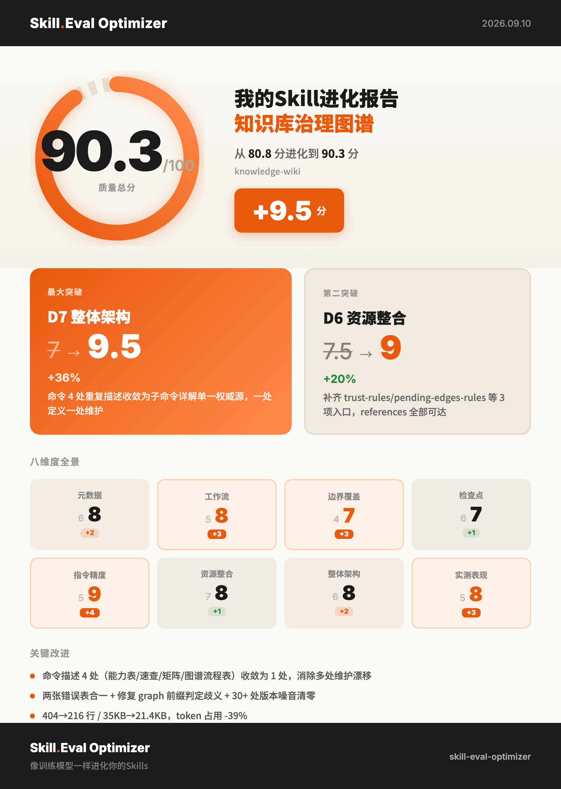

<div align="center">

# Skill Eval Optimizer 🧬

### 像训练模型一样进化你的 Skill：先评分，再爬坡，只留有效的改动。

一个用来评估和自动优化其他 agent skill 的 skill：**8 个维度打分（/100）**，专挑最弱维度改，分数真的涨了才保留——git 棘轮兜底，退步自动回滚。

[](LICENSE)
[](https://github.com/anthonyhann/skill-eval-optimizer/stargazers)
[](SKILL.md)
[](references/rubric.md)

[快速开始](#-快速开始) · [工作流](#-工作流) · [实测案例](#-实测案例) · [完整文档](SKILL.md) · [自带评测](evals/) · **[English README](README.md)**

</div>

## 📸 实测案例


> 本 skill 生成的真实成果卡片：**knowledge-wiki 80.8 → 90.3（+9.5 分）**，同时从 404 行精简到 216 行，token 占用下降 39%。

## 📈 实战成绩单

六个月的生产实证（**2026-04 至 2026-10**），每一条记录都由本 skill 自己打分：

- 管理 **49 个 agent skills**，累计 **342 条评分优化记录**
- **44 个**有完整基线的 skill 中 **40 个提升，平均 +9.9 分（/100）**——分数真涨才保留改动，否则回滚
- 最大逆袭：一个代码审查 skill **19 轮从 61.2 → 93.1** → [agentic-code-review](https://github.com/anthonyhann/agentic-code-review)；一个知识库 skill **67.8 → 90.3**，同时 token 占用 **−39%** → [knowledge-wiki](https://github.com/anthonyhann/knowledge-wiki)
- 它自己的基线分：**90.7 / 100**——优化器也优化它自己

## 😅 你的 skill 是不是也这样？

- 上周把某个 skill 的提示词改了三版。**到底有没有变好？没人知道——因为没有分。**
- skill 文件夹越攒越多：两个 skill 内容重叠，一个引用了已经不存在的命令，还有一个硬编码着数据库密码。
- 让 LLM 帮忙看看「这个 skill 写得怎么样」，它说「写得真好！」——然后下一次改动悄悄把触发词改没了。

这个 skill 把「凭感觉」换成一个闭环：**扫描 → 分流 → 评分 → 爬坡迭代 → 实测验证 → 保留或回滚**。

## 🔄 工作流

```
Phase 0    清单扫描      扫描 ~/.claude/skills + ./.claude/skills → JSON 清单
Phase 0.5  verdict 分流  5 项检查（重叠 / 规则冗余 / 时效性 / 使用频率 / 安全红线）
                         → 判定：Keep · Improve · Update · Retire · Merge · 🔴 Block
Phase 0.7  测试 prompt   每个 skill 设计 2-3 个真实 prompt → 物化为 skill-up 评测用例
Phase 1    基线评分      8 维 rubric：结构 6 维（60 分）+ 效果 2 维（40 分）→ /100
Phase 2    爬坡迭代      每轮只攻最弱维度（默认 ≤3 轮）；
                         分数涨 → 保留并 commit · 分数跌 → git revert，绝不用 reset --hard
Phase 3    报告 + 卡片   Before/After 对照、保留/回滚统计、可视化成果卡片（2x PNG）
```

人在回路是设计而非缺陷：每一轮改动前都有 **Round Gate**——展示要改的段落原文、改后预览、预期加分，你选「继续 / 跳过 / 结束」。命中安全红线（硬编码内网地址、数据库连接串、无防护的破坏性操作、不合规的远程访问）直接 **verdict=Block**，边界维度强制封顶 4/10。

维度 8（实测表现）不靠评审感觉——它用 [skill-up](https://github.com/alibaba/skill-up) 跑你的测试 prompt，`pass_rate × 10` 就是分数。同输入同结果，可以进 CI 做门禁。

## 🚀 快速开始

**前置依赖**：`bash` + `jq`（`brew install jq`）。成果卡片需要 Node + Playwright（可选）。维度 8 首次运行会自动安装 skill-up。

**1. 安装**（任何读取 `SKILL.md` 的 agent 都适用）：

```bash
git clone https://github.com/anthonyhann/skill-eval-optimizer ~/.claude/skills/skill-eval-optimizer
```

**2. 说一句话**：

```
/skill-eval-optimizer        # 全量：清单 → 分流 → 评分
```

或自然语言：*「优化我的 code-review skill」* · *「给所有 skill 打分」* · *「skill 健康状态」*

**给 AI agent 的安装口令**——直接把这句贴给你的 agent：

> 帮我安装 https://github.com/anthonyhann/skill-eval-optimizer 这个 skill 到我的 skills 目录（如 `~/.claude/skills/skill-eval-optimizer`），确认 `jq` 已安装，然后运行 `/skill-eval-optimizer`。

两条命令，一句话，结束。

## 📁 目录结构

```
skill-eval-optimizer/
├── SKILL.md                     # skill 本体：工作流、各 Phase、Round Gate、护栏
├── references/
│   ├── rubric.md                # 8 维评分 rubric + 安全红线规则（S002–S005）
│   ├── skill-up.md              # skill-up 确定性评分、回归锁、CI 字段
│   ├── output-templates.md      # 各 Phase 输出模板
│   └── health-panel.md          # 健康面板：保留率趋势 / 失败模式聚类 / 版本历史
├── scripts/
│   ├── scan.sh                  # skill 清单 + frontmatter + mtime + 7d/30d 使用估计
│   ├── quick-diff.sh            # 相对上次评估的变更检测
│   ├── save-results.sh          # 浅合并 results.json（UTC 时间戳）
│   └── screenshot.mjs           # 成果卡片 2x PNG 截图（Playwright）
├── templates/
│   ├── result-card.html         # 三主题卡片模板（swiss / terminal / newspaper）
│   └── card-knowledge-wiki.png  # 真实生成的成果卡片（见上图）
└── evals/                       # 本 skill 自己的 3 个评测用例——自己的狗粮自己吃
```

两个运行时文件只存本地、已 gitignore：`results.json`（快照 / Quick Scan 基准）与 `results.tsv`（append-only 实验日志）。

## ⚠️ 什么时候别用它

- **替代单元测试 / 集成测试。** 它评估和优化的是 *skill 提示词文件*，不管代码正确性。
- **评估非 skill 文件。** 它只认带 frontmatter 的 `SKILL.md`；丢给它一篇普通 markdown，它会（正确地）拒单。
- **想要无人值守的批量改写。** 每轮优化都要你确认——这是护栏，不是缺陷。
- **Windows 用户**：维度 8 会降级为 `dry_run`（skill-up 安装脚本仅支持 macOS/Linux）。结构维度 1-7 不受影响。

## License

MIT © [anthonyhann](https://github.com/anthonyhann)——如果这个工具把你的 skill 从「提示词腐化」里捞了回来，点个 ⭐，新维度上线时你会第一时间知道。
